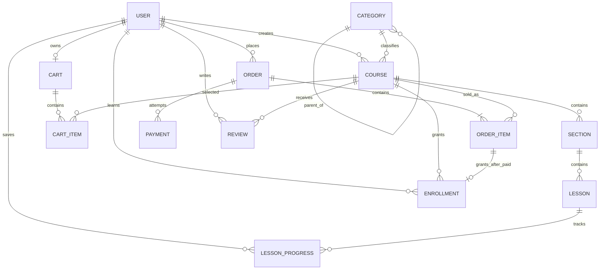
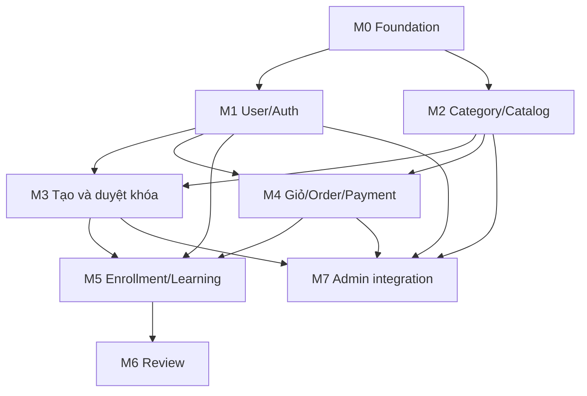

# Roadmap MVP marketplace khóa học

## 1. Phạm vi

Mục tiêu là website kiểu marketplace khóa học, đủ các luồng cốt lõi để trình diễn và chia việc nhóm:

- Người dùng xem danh mục, tìm khóa học và xem chi tiết/preview.
- Cùng một tài khoản có thể tạo khóa học để bán, đồng thời mua và học khóa khác.
- Người mua thêm khóa vào giỏ, thanh toán và được ghi danh sau khi thanh toán thành công.
- Học viên học bài, lưu tiến độ và đánh giá khóa đã mua.
- Admin duyệt/từ chối khóa; quản lý danh mục; xem khóa theo danh mục và xem nội dung chương/bài; cấm hoặc xóa tài khoản.

Giữ ngoài phạm vi MVP: Q&A, ghi chú, coupon, subscription, chứng chỉ, livestream, quiz nâng cao, đồng tác giả, payout tự động và báo cáo phân tích nâng cao.

Luồng tham khảo từ Udemy: [khám phá/xem trước/đọc đánh giá khóa học](https://support.udemy.com/hc/en-us/articles/229231027-How-to-preview-and-compare-courses), [tạo curriculum và quản lý khóa](https://support.udemy.com/hc/en-us/articles/230048607-How-to-Navigate-the-Course-Management-Dashboard), [giỏ hàng và mua khóa](https://support.udemy.com/hc/en-us/sections/206458408-Purchasing-a-course), [học và theo dõi tiến độ](https://support.udemy.com/hc/en-us/sections/206457187-Course-Player). Udemy dùng khái niệm instructor trong giao diện; roadmap này gộp thao tác đó vào cùng tài khoản `User` theo yêu cầu sản phẩm.

## 2. Quy tắc tài khoản và nghiệp vụ

- Chỉ có `User` và role hệ thống `USER`/`ADMIN`. Không tạo entity hoặc role `Instructor`.
- Mọi `USER` đều có thể vừa tạo khóa vừa mua/học khóa. Chủ khóa lấy từ `Course.creatorUserId` theo phiên đăng nhập, không nhận từ client.
- Trạng thái tài khoản: `ACTIVE`, `BANNED`, `DELETED`. Tài khoản bị cấm không được đăng nhập hoặc tạo giao dịch mới.
- Admin “xóa” tài khoản theo kiểu soft delete để giữ lịch sử đơn/ghi danh. Khóa của tài khoản bị xóa hoặc cấm có thể chuyển sang `HIDDEN` cho đến khi admin xử lý.
- Khóa chỉ công khai khi được admin duyệt và có trạng thái `PUBLISHED`. Khóa bị sửa sau khi xuất bản có thể quay lại `PENDING`.
- `Order` ghi nhận giao dịch; `Enrollment` là quyền học. Chỉ xác nhận thanh toán ở backend mới được tạo enrollment.
- Chỉ user đã ghi danh mới đánh giá khóa; một user có tối đa một đánh giá hiện hành cho mỗi khóa.

## 3. Luồng chức năng

### A. Khám phá khóa học

1. Khách xem danh mục phân cấp, danh sách khóa đã xuất bản và tìm kiếm theo tên.
2. Chọn danh mục hoặc danh mục con để lọc khóa.
3. Trang chi tiết hiển thị mô tả, mục tiêu, giá, thông tin người tạo, curriculum và đánh giá.
4. Khách chỉ mở được bài được đánh dấu preview.

### B. Đăng và duyệt khóa

1. User đăng nhập, tạo khóa `DRAFT`, thêm chương và bài học.
2. User gửi duyệt, trạng thái khóa thành `PENDING`.
3. Admin xem chi tiết khóa, chương/bài và duyệt (`PUBLISHED`) hoặc từ chối (`REJECTED`) kèm ghi chú.
4. Khóa `PUBLISHED` xuất hiện trong tìm kiếm và có thể được mua. User chỉ sửa khóa của mình.
5. Người tạo xem danh sách khóa của mình và số lượt ghi danh cơ bản.

### C. Giỏ hàng, thanh toán và ghi danh

1. User thêm hoặc bỏ khóa trong giỏ; không cho trùng khóa, mua khóa của chính mình hoặc mua lại khóa đã sở hữu.
2. Checkout tạo `Order` và `OrderItem` với giá/tên đã chụp tại thời điểm đặt.
3. Backend tạo `Payment` với cổng thanh toán sandbox hoặc cổng thật theo cấu hình.
4. Callback/IPN phải xác minh mã giao dịch, order và số tiền; xử lý lặp an toàn.
5. Khi payment thành công, order chuyển `PAID`, tạo enrollment cho từng order item và xóa các khóa đã mua khỏi giỏ.

### D. Học và đánh giá

1. Thư viện liệt kê khóa có enrollment còn hiệu lực.
2. Học viên xem bài, tiếp tục từ vị trí trước và đánh dấu hoàn thành.
3. Học viên đã ghi danh gửi/sửa đánh giá 1–5 sao và nhận xét.

### E. Quản trị

- Duyệt/từ chối khóa và đọc các mục curriculum.
- Quản lý cây danh mục; chọn danh mục để xem các khóa thuộc danh mục đó và các danh mục con.
- Mở một khóa để xem danh sách section/lesson.
- Xem danh sách user, cấm/mở cấm và xóa mềm tài khoản.
- Xem order/payment để hỗ trợ tra soát cơ bản.

## 4. Entity và thuộc tính cơ bản

Gợi ý kiểu dữ liệu PostgreSQL: ID `BIGINT`, mã order `UUID`, thời gian `TIMESTAMPTZ`; tiền dùng `BIGINT` theo đơn vị nhỏ nhất cùng `currency`, không dùng số thực.

| Entity | Thuộc tính MVP | Quy tắc chính |
|---|---|---|
| `User` | `id`, `email`, `passwordHash`, `displayName`, `role (USER/ADMIN)`, `status (ACTIVE/BANNED/DELETED)`, `createdAt`, `updatedAt`, `deletedAt?` | Email duy nhất; mật khẩu đã hash. Một user có thể là người tạo và người học. |
| `Category` | `id`, `parentId?`, `name`, `slug`, `description?`, `sortOrder`, `isActive` | `parentId` tự tham chiếu, null với category gốc; slug duy nhất. |
| `Course` | `id`, `creatorUserId`, `categoryId`, `title`, `slug`, `description`, `level`, `priceAmount`, `currency`, `thumbnailUrl?`, `status (DRAFT/PENDING/PUBLISHED/REJECTED/HIDDEN)`, `reviewedBy?`, `reviewedAt?`, `reviewNote?`, `createdAt`, `updatedAt` | Creator là User; admin duyệt. Category là category chính để lọc; khóa thuộc một category trong MVP. |
| `Section` | `id`, `courseId`, `title`, `position` | Chương thuộc khóa; `UNIQUE(courseId, position)`. |
| `Lesson` | `id`, `sectionId`, `title`, `type (VIDEO/TEXT)`, `contentUrl?`, `textContent?`, `durationSeconds`, `isPreview`, `position`, `isPublished` | Bài preview đọc công khai; bài còn lại cần enrollment. `UNIQUE(sectionId, position)`. |
| `Cart` | `id`, `userId`, `updatedAt` | Mỗi user có tối đa một cart đang hoạt động. |
| `CartItem` | `cartId`, `courseId`, `addedAt` | Khóa chính ghép `(cartId, courseId)` để không thêm trùng. |
| `Order` | `id`, `userId`, `status (PENDING/PAID/FAILED/CANCELLED/REFUNDED)`, `subtotalAmount`, `totalAmount`, `currency`, `createdAt`, `paidAt?` | Tổng tiền do backend tính; không lấy tổng tiền client gửi lên. |
| `OrderItem` | `id`, `orderId`, `courseId`, `courseTitleSnapshot`, `unitPriceAmount`, `currency` | Lưu tên và giá tại thời điểm checkout. |
| `Payment` | `id`, `orderId`, `provider`, `providerTransactionId?`, `amount`, `currency`, `status (CREATED/PROCESSING/SUCCEEDED/FAILED/REFUNDED)`, `createdAt`, `completedAt?` | Lưu từng lần thử thanh toán; giao dịch provider nếu có phải duy nhất. |
| `Enrollment` | `id`, `userId`, `courseId`, `orderItemId`, `status (ACTIVE/REVOKED)`, `enrolledAt`, `revokedAt?` | `UNIQUE(userId, courseId)`; chỉ tạo sau khi order đã paid. |
| `LessonProgress` | `id`, `userId`, `lessonId`, `completed`, `positionSeconds`, `updatedAt` | `UNIQUE(userId, lessonId)`; lesson phải thuộc khóa đã ghi danh. |
| `Review` | `id`, `userId`, `courseId`, `rating`, `comment?`, `createdAt`, `updatedAt` | `UNIQUE(userId, courseId)`; rating từ 1 đến 5; cần enrollment. |

Không cần `Student`, `Instructor`, `InstructorProfile` hoặc `CourseInstructor` riêng. Bảng `Enrollment` và `Course.creatorUserId` liên kết cùng một `User` với hai hành động khác nhau.

## 5. ERD

`Course.reviewedBy` là quan hệ tới `User` có quyền admin. Category là cây tự tham chiếu; khi admin mở một category, backend có thể liệt kê khóa gắn với category đó và các category con.

## 6. Modules, phụ thuộc và chia việc

| Module | Nhiệm vụ chính | Entity/API sở hữu | Phụ thuộc |
|---|---|---|---|
| M0 — Foundation | Cấu hình DB, migration, error response, session/CSRF, enum và API convention | Khung chung | — |
| M1 — User/Auth | Đăng ký, đăng nhập, logout, current user, role admin, ban/unban/delete-soft | `User`; `/auth/*`, `/admin/users/*` | M0 |
| M2 — Category/Catalog | CRUD category, category tree, list courses theo category, tìm kiếm, course detail và preview | `Category`; public `/categories`, `/courses/*` | M0; auth chỉ cần cho wishlist không nằm trong MVP |
| M3 — Course authoring/moderation | Tạo/sửa draft, curriculum, upload video, submit, approve/reject/hide, admin xem section/lesson | `Course`, `Section`, `Lesson`; `/creator/courses/*`, `/admin/courses/*` | M1, M2 |
| M4 — Cart/Order/Payment | Add/remove cart, checkout snapshot, payment sandbox/provider, callback, order history | `Cart`, `CartItem`, `Order`, `OrderItem`, `Payment` | M1, M2 |
| M5 — Enrollment/Learning | Cấp quyền học sau payment, library, lesson access, progress/resume | `Enrollment`, `LessonProgress` | M3, M4, M1 |
| M6 — Review | Tạo/sửa đánh giá, tính rating trung bình và số lượt đánh giá trên course | `Review` | M5 |
| M7 — Admin integration | Màn hình quản lý category, khóa, user, order; ghép và seed luồng đầy đủ | Dùng entity M1–M4 | M1, M2, M3, M4 |

### Gợi ý chia cho nhóm 5 người

| Thành viên/nhóm | Phạm vi | Điểm bàn giao |
|---|---|---|
| 1 | M0 + M1 | Database/auth chạy; API trả đúng user hiện tại; quy tắc admin/ban account |
| 2 | M2 | Category phân cấp, tìm kiếm, trang danh sách/chi tiết khóa |
| 3 | M3 | Creator dashboard, curriculum, trạng thái duyệt và admin xem nội dung khóa |
| 4 | M4 | Giỏ hàng, order snapshot, payment adapter và callback |
| 5 | M5 + M6 + tích hợp UI | Enrollment, thư viện, progress, review; nối luồng buyer |

Admin pages quản lý category/user/order có thể chia cho người 1 hoặc 2 theo mức tải; không đổi ownership của entity và migration đã giao cho module chính.

## 7. Thứ tự triển khai theo luồng

1. **Catalog demo:** seed category/course → xem cây danh mục → list/filter/detail → xem preview.
2. **Bán khóa:** đăng nhập → user tạo draft → thêm section/lesson → gửi duyệt → admin publish → khóa hiện trong catalog.
3. **Mua khóa:** thêm 1+ khóa vào cart → checkout → payment sandbox → order paid → enrollment → thư viện.
4. **Học và review:** kiểm quyền lesson → lưu progress → gửi review chỉ khi enrolled.
5. **Admin:** xem khóa theo category và curriculum → approve/reject/hide → ban/delete account → tra cứu order.

### Điều kiện hoàn thành

- User A tạo được khóa nhưng không sửa khóa của user B.
- Khóa chưa duyệt hoặc bị ẩn không xuất hiện công khai.
- Admin duyệt được khóa, xem được các section/lesson của khóa và liệt kê các khóa trong từng category.
- Checkout lưu đúng snapshot giá; callback thanh toán sai chữ ký/số tiền không tạo enrollment.
- Thanh toán thành công chỉ tạo một enrollment dù callback gửi lặp.
- User chỉ học bài trả phí sau khi được ghi danh; preview vẫn xem được công khai.
- Chỉ user đã ghi danh đánh giá; user bị cấm không tiếp tục mua hoặc đăng khóa.
- Xóa tài khoản không làm mất lịch sử order/enrollment; trạng thái là `DELETED` và thông tin cá nhân được ẩn/anonymize theo chính sách.
